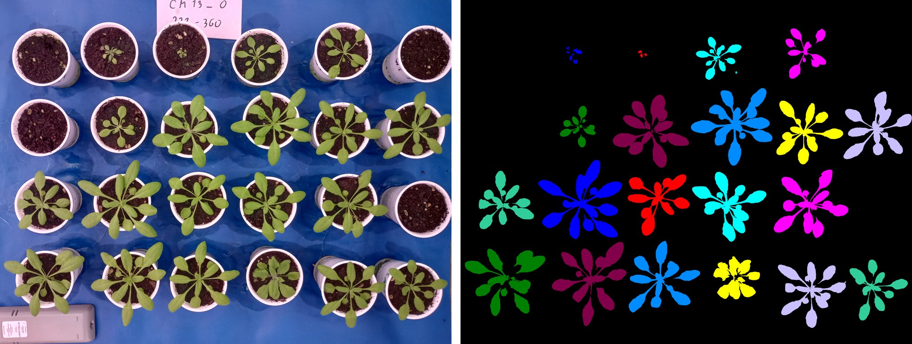
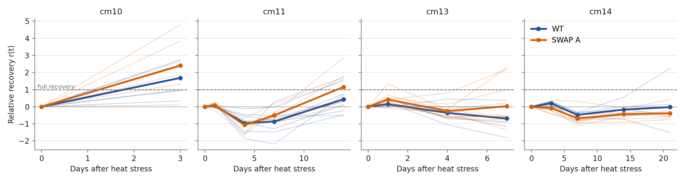
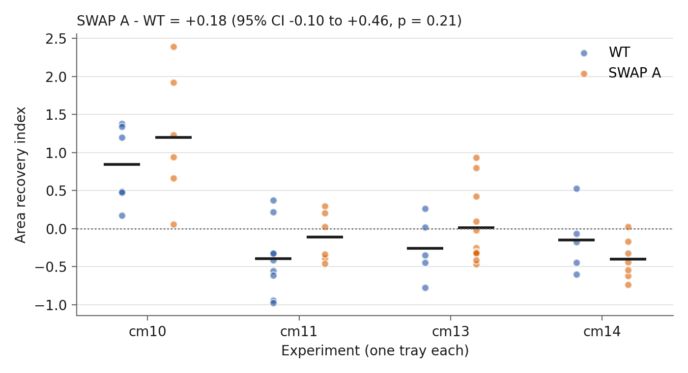

# Plant stress phenotyping: from tray photos to a recovery metric

Do *Arabidopsis* plants carrying the SWAP A mutation recover better from a heat shock than wild type (WT)?
This repo turns overhead photos of plant trays into per-plant measurements. It then summarises each plant's
recovery in a single number and tests the genotype effect across four independent experiments.



## Pipeline

1. **Image segmentation** (`phenotyping/segmentation.py`): PlantCV converts the photo to LAB, thresholds the
   green-magenta channel, removes small specks and assigns each plant to its pot with an automatic grid. It
   measures size, shape and colour traits per plant and converts pixels to cm using a pot of known diameter.
2. **Time series** (`phenotyping/timeseries.py`): one CSV per photo becomes a tidy table with one row per plant and
   day (pre-stress, day 0 and recovery days 1 to 21).
3. **Cleaning** (`experiments.toml`): every exclusion is declared per experiment instead of hidden in code. That
   covers controls, seedlings that never established, plants dropped after manual photo review, and the recovery
   window.
4. **Recovery index** (`phenotyping/recovery.py`), see below.
5. **Inference** (`run_analysis.py`): the genotype effect is estimated with experiment as a block, plus figures.

## The recovery index

Heat stress shrinks the rosette. With `x_pre` the area before the stress and `x_s` the area right after it,
relative recovery on day *t* is

    r(t) = (x(t) - x_s) / (x_pre - x_s)

so `r = 0` means no recovery and `r = 1` means back to the pre-stress size. The index is the time average of r(t)
over the recovery window, `(1/T) * integral of r(t) dt`, computed with the trapezoid rule. That way the irregular
photo days (0, 1, 4, 7, 14...) need no resampling, and windows of different length stay comparable. Plants that
did not lose area have no loss to recover from, so they get no index.



## Result



| | Estimate |
|---|---|
| SWAP A - WT, recovery index | +0.18 |
| 95% CI | -0.10 to +0.46 |
| p | 0.21 |
| Plants (experiments) | 55 (4) |

SWAP A recovered more than WT in three of the four trays, but the pooled difference is not significant. The
experiments differ much more from each other than the genotypes do (cm10 sits far above the rest), and in
three of them the average plant kept losing area after the stress (negative index). That is why plants are not
pooled as if they were independent: an OLS model with `experiment` as a fixed block and HC3 robust errors
compares genotypes *within* each tray. Dropping cm10 does not change the conclusion (+0.13, 95% CI -0.14 to +0.39).

## Run it

```bash
pip install -r requirements.txt
python run_analysis.py      # writes results/recovery_index.csv and the figures in img/
python -m pytest            # tests for the recovery index
```

To segment a new photo:

```python
from phenotyping.segmentation import measure_tray

traits = measure_tray("data/sample/cm13_0.jpg", rows=4, cols=6, px_per_cm=72.03, first_plant=337)
```

## Data

`data/raw/<experiment>/` holds the PlantCV output for each photo of each tray (only the analysed trays are
included). `data/sample/` has one original photo to try the segmentation. The data come from my PhD work on
heat stress in *Arabidopsis thaliana*.
